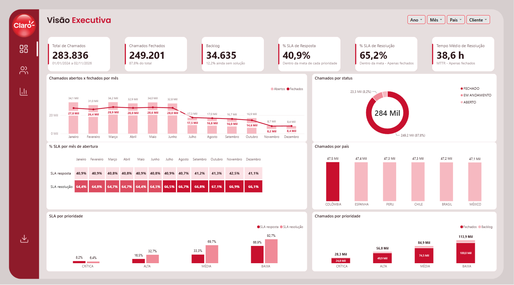
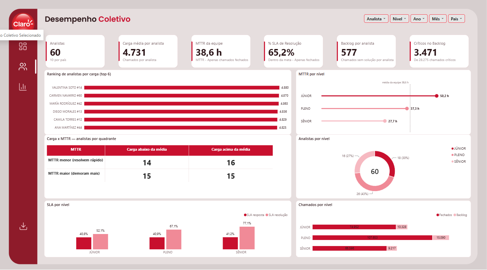
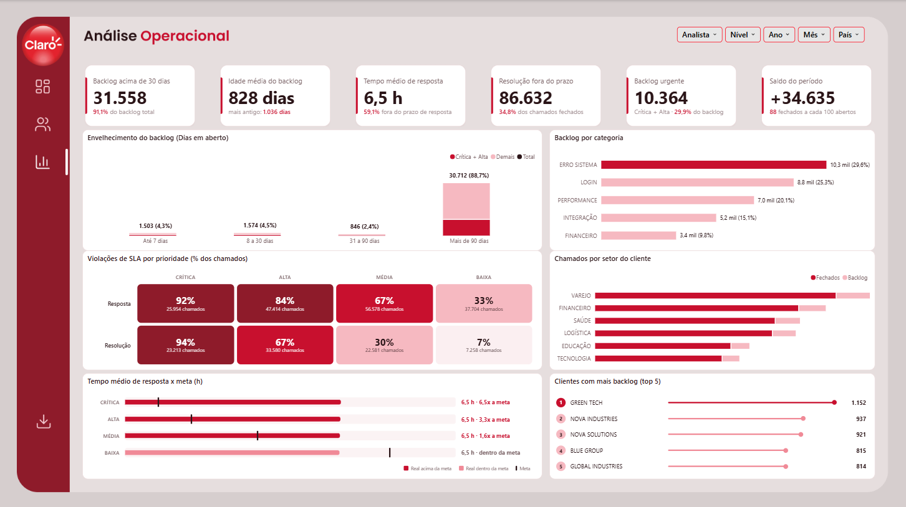

# 🎧 Performance de Suporte | Python, SQL Server, Power BI & Power Automate



<p align="center">
  <a href="https://app.powerbi.com/view?r=eyJrIjoiZjMxZTJhOGMtYTk0Yy00MGI0LWJlY2EtNzczNmUxMzYwZTZjIiwidCI6ImIxZjQxMDEzLWU0NDUtNGIzNS1hNzA4LTA2YTk5ZTZjZWQ2ZSJ9"></a>
</p>

> 🔓 **Relatório interativo aberto**, sem login: clique no botão acima. Todos os dados são fictícios. Nesta versão pública a segurança por país (RLS) foi removida, então todos os 6 países aparecem.

## 📌 Sobre o Projeto

Projeto de portfólio que analisa a operação de **suporte técnico de uma empresa multinacional fictícia**, com atendimento em **6 países** (Brasil, Chile, Peru, México, Colômbia e Espanha). A base cobre de **janeiro de 2024 até hoje**, com **mais de 280 mil chamados**, **60 analistas** e **300 empresas clientes**, e recebe chamados novos todos os dias por uma carga automática.

O objetivo foi responder a três perguntas de negócio, uma por página do dashboard:

| Página | Pergunta |
|:--|:--|
| **Visão Executiva** | Como está o suporte? |
| **Desempenho Coletivo** | Quem está performando? |
| **Análise Operacional** | Onde estão os problemas? |

> ⚠️ **Todos os dados são fictícios**, gerados por scripts em Python. Nenhuma empresa, pessoa, e-mail ou chamado é real.
>
> 🎨 **Sobre a marca:** o dashboard usa apenas o **branding da Claro** (logo e cores) como referência visual de layout. Nenhum dado, número ou informação da Claro foi utilizado, e o projeto não tem vínculo com a empresa.

## 🎯 Principais Resultados

*Leitura feita sobre os dados de 01/01/2024 a 02/11/2026 (momento dos prints).*

| Indicador | Resultado | Leitura |
|:--|:--:|:--|
| **% SLA de Resposta** | 40,9% | Menos da metade dos chamados recebe a primeira resposta dentro da meta |
| **% SLA de Resolução** | 65,2% | Considera apenas chamados fechados |
| **Tempo médio de resolução (MTTR)** | 38,6 h | Júnior 50,2 h · Pleno 37,3 h · Sênior 27,7 h |
| **Backlog** | 34.635 | 12,2% do total ainda sem solução |
| **Saldo do período** | 88 fechados a cada 100 abertos | A fila cresce mais rápido do que é resolvida |

- **Quanto mais urgente, pior o SLA:** chamados de prioridade **Crítica** cumprem só **8,2%** da meta de resposta e **6,4%** da de resolução, contra **66,9%** e **92,7%** na prioridade **Baixa**. As metas mais curtas são exatamente as mais violadas.
- **Backlog envelhecido:** **88,7%** do backlog tem mais de 90 dias em aberto, e **29,9%** dele é de prioridade Crítica ou Alta.
- **Senioridade pesa no tempo:** analistas Sênior resolvem em quase metade do tempo dos Júnior e têm o melhor SLA de resolução (77,1% contra 52,1%).
- **Problemas concentrados:** *Erro de sistema* e *Login* somam **54,9%** do backlog por categoria.

## 🏗 Arquitetura de Dados e Modelagem

**Fluxo:** Python (dados fictícios) → SQL Server (esquema `dw`) → Power BI (modo Import) → Power BI Service, com Power Automate conferindo a carga.

```
Python (dados fictícios) ──► SQL Server (schema dw) ──► Power BI (Import) ──► Power BI Service
        ▲                           │
        │                           └── procedures ◄── Power Automate (fluxos na nuvem)
Agendador do Windows (10h)
```

O modelo segue um **esquema estrela**:

| Tabela | Tipo | Granularidade |
|:--|:--:|:--|
| `fato_chamados` | Fato | Um chamado por linha (abertura, fechamento, prioridade, status, tempos e flags de SLA) |
| `dim_calendario` | Dimensão | Data (chave `id_data` no formato yyyymmdd) |
| `dim_analista` | Dimensão | Analista, nível e país (10 por país) |
| `dim_cliente` | Dimensão | Empresa cliente e setor |
| `dim_pais` | Dimensão | País de atendimento |
| `dim_supervisor` | Segurança | Supervisor e perfil (Supervisor ou Gestor) |
| `supervisor_pais` | Segurança | Quais países cada supervisor enxerga |

- As medidas DAX ficam organizadas em **pastas por página**.
- Metas de SLA por prioridade (resposta / resolução): **Crítica** 1 h / 8 h · **Alta** 2 h / 24 h · **Média** 4 h / 48 h · **Baixa** 8 h / 72 h.

## 📐 Indicadores e Premissas

O dashboard trabalha com KPIs de volume, prazo e fila: total de chamados, fechados, backlog, % SLA de resposta e de resolução, MTTR, carga por analista, críticos no backlog, idade do backlog e saldo do período. Algumas premissas:

- **SLA pela meta de cada prioridade:** um chamado Crítico e um de prioridade Baixa não são medidos com a mesma régua.
- **Resolução só com chamados fechados:** o % SLA de resolução e o MTTR ignoram chamados ainda abertos, para não misturar tempo real com tempo parcial.
- **Backlog por idade:** além do tamanho da fila, o dashboard mostra há quanto tempo os chamados estão parados (até 7 dias, 8 a 30, 31 a 90 e mais de 90).
- **Saldo do período:** compara abertos e fechados para mostrar se a operação está vencendo a demanda ou acumulando fila.
- **Dashboard somente leitura:** o gerenciamento dos chamados fica em outra plataforma (simulada pelo Python). O relatório só observa, nunca age sobre os chamados.

## 🔐 Segurança (RLS)

**RLS dinâmica por e-mail:** cada supervisor vê apenas os chamados do seu país, e o perfil **Gestor** vê os 6 países. A regra lê o e-mail do usuário logado nas tabelas `dim_supervisor` e `supervisor_pais` e foi validada com **"Exibir como"** no Power BI Desktop.

## ⚙️ Automação

1. **Carga diária:** o Agendador de Tarefas do Windows roda `rodar_carga_diaria.bat` às 10h, que executa `gerar_chamados_diario.py` (carga incremental de chamados novos), com log em arquivo.
2. **Conferência da carga:** fluxo na nuvem do Power Automate (10h30) chama a procedure `dw.usp_status_carga` pelo gateway local e envia um resumo por e-mail (situação, totais e último chamado).
3. **Novo supervisor:** fluxo que chama `dw.usp_upsert_supervisor`, atualiza a base da RLS e envia um e-mail de boas-vindas.
4. **Planejados:** alerta de SLA por país e relatório semanal por supervisor (dependem da publicação no Power BI Service).

## 🛠 Tecnologias e Ferramentas Utilizadas

- **Python (pandas, pyodbc):** geração dos dados fictícios e carga diária incremental
- **SQL Server:** armazenamento, modelagem dimensional (esquema `dw`) e procedures
- **Power BI Desktop (PBIP):** modelo semântico e relatório em formato de projeto, versionável no Git
- **Power Query:** conexão e carga das tabelas (modo Import)
- **DAX:** cálculo dos KPIs, regras de RLS e geração do HTML/SVG dos cards
- **Power Automate:** fluxos na nuvem ligados ao SQL Server pelo gateway local
- **Agendador de Tarefas do Windows:** execução diária da carga

## 📊 Estrutura do Dashboard

### Visão Geral das Páginas

| Visão Executiva | Desempenho Coletivo |
|:--:|:--:|
|  |  |

| Análise Operacional |
|:--:|
|  |

- **Visão Executiva:** os 6 KPIs principais, abertos x fechados por mês, mapa de calor do % SLA por mês, chamados por status, país e prioridade.
- **Desempenho Coletivo:** ranking de analistas por carga, MTTR e SLA por nível (Júnior, Pleno e Sênior) e quadrante de carga x MTTR.
- **Análise Operacional:** envelhecimento do backlog, violações de SLA por prioridade, tempo de resposta contra a meta, backlog por categoria e setor e os clientes com mais chamados parados.

## 💡 Funcionalidades e UX/UI Aplicadas

- **Cards gerados por DAX:** os KPIs são escritos em HTML e SVG dentro das medidas, com uma linha de contexto embaixo de cada número (período, % do total, base do cálculo).
- **Navegação lateral:** menu fixo com ícones para trocar de página e um botão de download.
- **Filtros por página:** ano, mês, país, cliente, analista e nível, sempre no mesmo lugar no topo.
- **Quadrante de carga x MTTR:** separa os analistas em quatro grupos (muita carga e rápidos, pouca carga e lentos etc.) para orientar redistribuição de trabalho.
- **Destaque por cor:** o vermelho forte marca o maior valor ou o ponto de atenção, e os tons claros ficam para o contexto.
- **Segurança invisível ao usuário:** com a RLS, o supervisor abre o mesmo relatório e já vê só o seu país, sem precisar filtrar.

## ⚠️ Limitações Conhecidas

- A carga diária só roda com o computador ligado e o usuário logado.
- O conector SQL do Power Automate é premium (o projeto usa licença de teste).
- Os fluxos de alerta de SLA e de relatório semanal dependem de publicar o relatório no Power BI Service.

---

Desenvolvido por **Lucas Oliveira** · [LinkedIn](https://www.linkedin.com/in/lucas-santos-social/)
